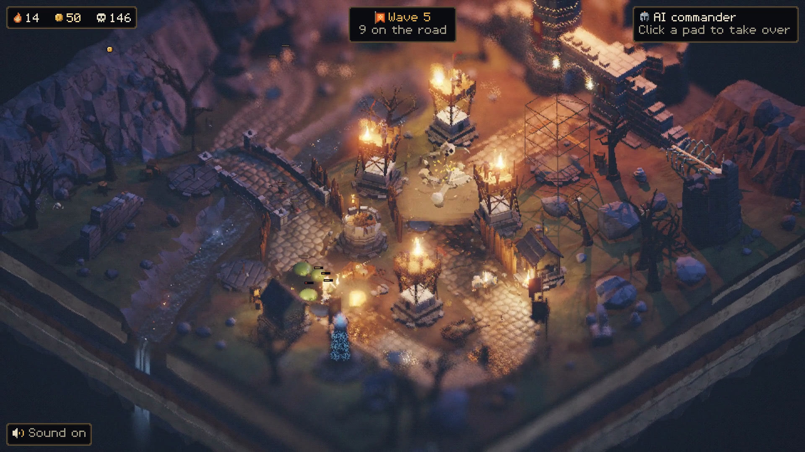
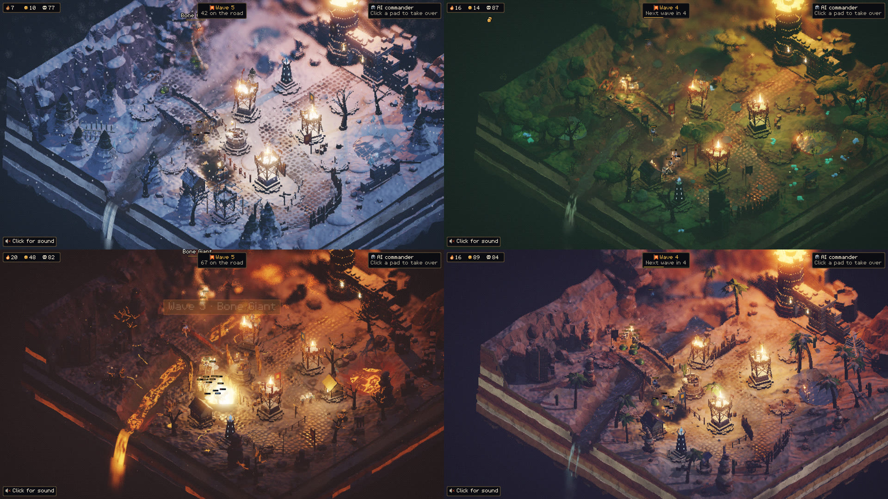
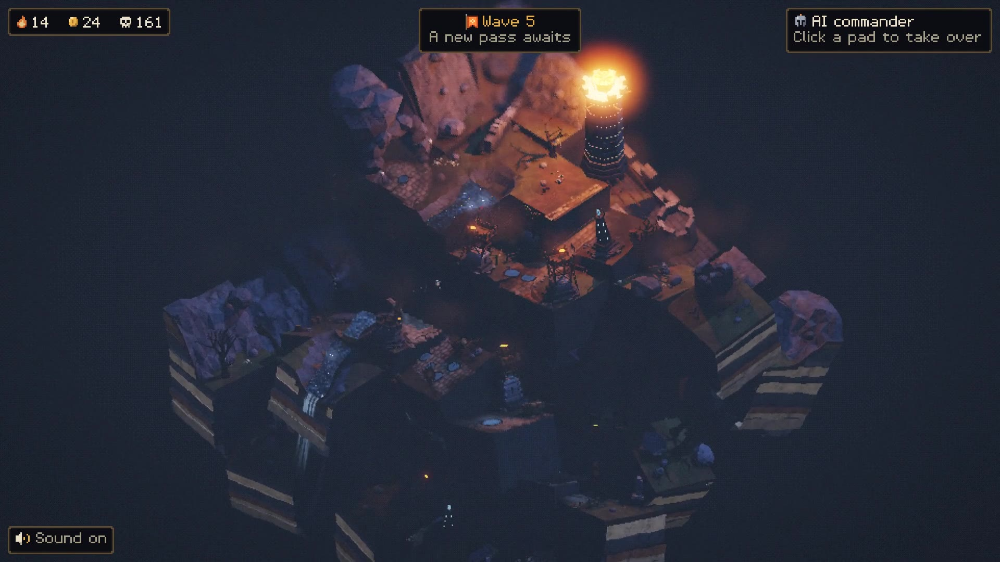

# Cinderwatch

A self-playing 3D isometric tower defense in a single HTML file.

A handful of firelit towers hold the great beacon of a ruined keep against endless columns of monsters, across five lands from a dark mountain pass to a snowfield, a bog, a lava scar and a desert at dusk. An AI commander plays from the moment the page loads, and you can take over at any time.

**[Play it in your browser](https://kevintngo.github.io/cinderwatch/)** · [Watch 20 seconds of gameplay](https://kevintngo.github.io/cinderwatch/media/gameplay-20s.mp4)



## What is in it

- **Four towers, four levels each**, raised piece by piece inside scaffolding: archer tower, bombard, storm spire and guard post. At the fourth level each tower takes one of two paths:
  - archer tower: a **crossbow tower** whose bolts fly far, hit hard and punch through armor, or **venom archers** whose poison keeps hurting for three seconds
  - bombard: a **rocket battery** that fires salvos at very long range, or a **great cannon** whose wide blast staggers everything it hits
  - storm spire: a **thunder spire** whose longer chains leave live roots in the ground, or a **plasma spire** whose single beam burns hotter the longer it holds
  - guard post: a **knight hall** of armored knights who hold more enemies at once, or an **assassin den** of quick blades that dodge, catch spiders and cut wraiths
- **Twenty-four kinds of monster**, each with its own model and trick. Skeletons, giant rats, slimes that split, shield-bearing knights and bats are joined by:
  - ghouls that run faster as they are hurt, dire wolves, and cave spiders and scarabs that slip past the guards
  - sappers whose powder keg blows up friend and foe, and wraiths that arrows and swords pass through while they fade
  - war drummers that speed up everything near them, and necromancers that raise more skeletons
  - bog toads, mummies that burst into scarabs, and brood mothers that burst into spiders
  - trolls that heal, stone golems that shrug off arrows, and gargoyles and glowing wisps in the air
  - on later battlefields: ash thieves that stay hidden until close to a tower and steal gold if they reach the fire, rust hags that slow nearby towers and cure poison, shield wardens whose dome stops arrows, bolts and shells (but not lightning), and armored ember drakes that burn footmen from the air
- **A boss on every fifth wave, one per land**: the Bone Giant, the Frost Jotun that freezes towers, the Brood Queen, the Magma Colossus and the Buried King, with the Ogre waiting on a second visit to Ashen Pass (and the Drowned Admiral, the Crystal Wyrm, the Bell Lich and the Storm Roc in the second campaign). Each land also favors its own monsters, and tints some of them to match.
- **Battlefields that rebuild themselves.** After each boss the slab crumbles away and a new one, with a different road, assembles out of the dark.
- **Five lands.** Each new battlefield is in the next one: Ashen Pass, Frostfall (snow, a frozen stream and falling snow), Mirefen (bog pools, willows, glowing mushrooms and fireflies), Emberscar (a lava river, charred trees and ash) and Duskmesa (dunes, palms and an oasis). A page opened without a seed starts in a random one.
- **Light as the main character.** A flickering beacon, a brazier on every tower, flaming arrows, cannon flashes and chain lightning, with moving shadows.
- **A second campaign, in progress.** *The Far Reaches* takes turns between four new lands, played with `#campaign=deep` for now (later the campaigns unlock one after another). None of them appears in the first campaign, so its balance is untouched.
  - **Saltreach**, a drowned coast at night: black sand, shipwrecks, sea walls, rain and a lighthouse whose beam sweeps the field. The tide comes and goes; at high tide about a third of the road floods and everything wading through it, footmen too, slows down. Its boss is the Drowned Admiral, who calls drowned sailors to his side and is not slowed by the tide.
  - **Glimmerdeep**, a crystal cavern with no sky. When chain lightning hits a monster near one of the big crystals beside the road, the crystal discharges at up to three monsters around it, so spires built near crystals pay off. Its boss is the Crystal Wyrm, which burrows under the road, out of reach, and comes up closer to the fire.
  - **Hollowmere**, a ruined gothic city under a big pale moon: a broken cathedral with stained glass, street lamps, graves and fallen leaves. Every half minute the cathedral bell tolls and, for a few seconds, every skeleton, ghoul and wraith hurries. Its boss is the Bell Lich, who raises the fallen near him as skeletons.
  - **Stormcrown**, a stormy mountain pass with wind-bent pines, prayer flags and a white shrine. Lightning strikes the road every ten seconds or so; a glowing ring marks the spot a moment before, and the bolt hurts everything there, footmen too. Its boss is the Storm Roc, the first flying boss: only archers and spires reach it, and its own lightning stuns towers.
  - **Road shapes of their own.** The first campaign's roads wind from the cave to the keep at random. In the second campaign each visit to a land brings the next of three shapes: a **switchback** of three long lanes stacked across the board, where a tower between two lanes covers both; a **horseshoe** that runs out to the front and back in one big U, often with a wide bulb, with pads inside reaching both legs; and a **ring road** that circles a small castle in the middle of the board before turning in at its gate, the beacon burning on its central tower.
  - **Enemies of its own**, 25 of them, each land with its own crowd and its own filler: orc raiders, gulls, shore crabs, moray eels that race through the tide, drowned sirens whose song slows towers and shellbacks only an explosion can flip in Saltreach; kobold miners, crystal mites, burrowing moles, shard golems and geode beetles in Glimmerdeep; zombies, crows, banshees that stun footmen, gravekeepers and corpse carts in Hollowmere; goblins, goats, kite riders that glide in and land, spark sprites lightning can't touch, orc shamans and warchiefs and boulder-throwing hill giants in Stormcrown. The full list is in [docs/enemies.md](docs/enemies.md).
  - More land ideas are in [docs/lands.md](docs/lands.md).
- **A miniature look.** The scene is drawn at about half resolution, then given an ordered dither, a depth-aware tilt-shift blur, a vignette and film grain.
- **No asset files.** Every model, texture and sound is generated in code.
- **Small comforts.** The first time each monster appears, a line says what it does. Tower menus show what the next level brings. The wave plate shows the gold for calling a wave early. Your best wave and your mute setting are remembered.
- **Settings and records.** The gear button next to the zoom buttons (or `O`) pauses the game and opens a panel with sound, speed, blur, screen shake, graphics (auto, or fast for slow phones), the frame rate and help (the controls hint at the bottom, shown during the first five waves of a run unless switched off), your records for this run and for all runs (best wave cleared, enemies slain, gold earned, lives lost) and the credits. A page opened with `level=`, `k=` or `ff=` is a test, so its first run is not added to the records.





## Controls

The game needs no input. Your first command puts you in charge, and the AI commander stays out until you hand the battle back.

| Input | Action |
| --- | --- |
| Hover a pad or tower | Highlight it and show its range |
| Click or tap an empty pad | Open the build menu |
| Click or tap a tower | Upgrade or sell |
| `1` to `4` | Pick a tower kind; in a level 3 tower's menu, `1` or `2` picks its path |
| `U` | Upgrade the hovered or selected tower (at level 3 it opens the path choice) |
| `X` | Sell the selected tower (press twice, or click Sell twice, to confirm) |
| `Space` | Call the next wave early |
| `C`, or click the commander plate | Hand command back to the AI, or take it |
| `M` | Mute (remembered for next time) |
| `O`, or the gear button | Settings, records and credits; `Esc` closes them |
| `P` | Pause; you can still look around and build |
| `Tab` | Game speed: 1x, 2x, 3x |
| Mouse wheel or trackpad pinch | Zoom toward the pointer |
| `+` and `-`, or the buttons in the corner | Zoom in and out |
| Drag the ground, arrow keys or `W` `A` `S` `D` | Move the view |
| Double-click the ground | Zoom in there; again to zoom back out |
| `F`, `0`, or the Follow the fight button | Hand the view back to the camera |
| `Esc` | Close the menu |
| Gamepad | Stick or D-pad selects a pad, A opens and confirms, B closes, X upgrades, Y calls the next wave |

Browsers keep audio off until a gesture, so the first click, tap or key press turns the sound on.

### On a phone or tablet

The game plays in portrait and in landscape, and follows the screen when it turns.

| Touch | Action |
| --- | --- |
| Tap an empty pad | Open the build menu |
| Tap a tower in the menu | Show what it does and its range; tap it again to build |
| Tap a built tower | Upgrade, or sell (sell asks for a second tap); at level 3, tap a path to see it and tap it again to take it |
| Tap the wave plate | Call the next wave early |
| Tap the commander plate | Hand command back to the AI, or take it |
| Drag | Move the view |
| Pinch, or the + and - buttons | Zoom, out to the whole battlefield |
| Double-tap the ground | Zoom in there; again to zoom back out |
| Follow the fight | Hand the view back to the camera |
| The buttons along the bottom | Pause, game speed, sound, settings, zoom and, where the browser allows it, full screen |

The layout keeps clear of notches and home indicators, buttons are sized for fingers, the screen is asked to stay awake while the game is open, and sound stops when the page is in the background. Added to the home screen, it opens full screen.

The browser's own double-tap and pinch zoom are turned off on the page, so the view can never get stuck zoomed in; zooming is done by the game, and every way in has a way back out.

Touch was tested with Chrome's phone emulation, not on real phones. Gamepad input has not been tested on real hardware.

## Run it

Open `index.html`. It works from `file://` with no server, no build step and no network.

### As an Android app

`android/` holds a small app that plays the same `index.html` full screen and offline, installed from an APK without Google Play. See [android/README.md](android/README.md) to build and install it.

### As an iOS app

`ios/` holds the same kind of app for iPhone and iPad, an Xcode project around the same `index.html`. See [ios/README.md](ios/README.md) to build it and get it onto a device.

### Building everything at once

```bash
tools/apps.sh              # web build, Android APK and iOS .ipa into dist/
tools/apps.sh android      # or only some of: web android ios
```

It prints one line per step and keeps the full output in `dist/logs/`. The APK is built locally (JDK 17 and the Android SDK). The iOS app needs Xcode, so on a Mac it is built locally; anywhere else the script downloads the unsigned `.ipa` that the iOS workflow built on GitHub for the current commit, so push first. Both workflows cancel a build that a newer push to the same branch makes obsolete.

## Build it

```bash
python3 tools/build.py
```

This joins `src/*.js` into `index.html` and inlines three.js from `vendor/`.

## Layout

| Path | Contents |
| --- | --- |
| `index.html` | The built game |
| `src/00-util.js` | Math, random numbers, noise |
| `src/10-gfx.js` | Procedural textures, the lit material, the geometry builder |
| `src/20-post.js` | Renderer and post-processing |
| `src/29-biome.js` | The five lands: palettes, light, weather and water settings |
| `src/30-layout.js`, `31-terrain.js`, `32-props.js`, `33-flora.js` | Road, stream and pad layout, terrain, scenery, plants and props of each land |
| `src/40-fx.js`, `41-weather.js` | Lights, particles, lightning, decals, snow, ash, dust and fireflies |
| `src/50-rig.js`, `51-bestiary.js` | Characters built from instanced parts, debris, the models of the later monsters |
| `src/60-towers.js`, `61-monsters.js`, `62-game.js` | Towers, monsters and the crowd, waves and the AI commander |
| `src/63-lands.js` | What only some lands have: the tide, the lighthouse beam, the crystals, the bell, the lightning |
| `src/64-foes.js` | The second campaign's own enemies: stats, models and abilities |
| `docs/lands.md` | Ideas for new lands |
| `docs/enemies.md` | Every enemy, which lands send it, and how to add one |
| `src/70-pixelfont.js`, `72-ui.js` | Pixel font, HUD, menus, input |
| `src/80-audio.js` | Synthesized sound |
| `src/90-main.js` | Camera and main loop |
| `tools/` | Build script and test tools |
| `android/` | The Android app |
| `ios/` | The iOS app |

## Development tools

Both tools drive headless Chrome and need Node 22 or newer. Set `CHROME` if Chrome is not in the default macOS location, and `FFMPEG` if `ffmpeg` is not on your path.

```bash
node tools/cdp.js "seed=4&ff=30" wait:2000 shot:battle eval:"__cw.G.lives"
```

`cdp.js` runs the game in real time and accepts `wait`, `shot`, `eval`, `click`, `move` and `key` steps. Screenshots go to `tools/shots/`. With `MOBILE=1` (and `DPR=3` for a phone's pixel density) it emulates a touch screen of the given size and also accepts `tap`, `drag`, `pinch`, `rotate` and `safe` steps:

```bash
MOBILE=1 DPR=3 node tools/cdp.js "seed=4" 390,844 wait:2000 tap:195,500 shot:phone rotate:844,390 shot:phone-wide
```

```bash
node tools/record.js scan 4 200
node tools/record.js capture 4 5130-5490,9870-10230 out.mp4
```

`record.js` steps the game at a fixed 1/60 s, so a seed always replays the same way. `scan` logs what happens when, `stills` saves frames, and `capture` writes a video of the given frame ranges with the game's own audio.

```bash
node tools/balance.js 1-8 90
node tools/balance.js 1-8 60 level=5
```

`balance.js` lets the AI commander play each seed headless, without drawing, until its first defeat or the time limit in game minutes (90 minutes takes well under a minute per seed). It reports the wave each seed reached, how much damage each tower deals at level 3 and on each level 4 path, and for every battlefield the lives lost to regular waves and to the boss, how often the boss got through, and the unspent gold at the start of waves 2 to 4 and before the boss. Seeds run in parallel; by default about half the CPU is used (one seed per two cores), and `JOBS=n` sets how many run at once. `B=1` adds a line per battlefield, `V=1` a line per wave, `FILE=other.html` tests another build, and `LCAP=14` splits the later battlefields further. On Linux it uses software WebGL, so Chrome for Testing's `chrome-headless-shell` works as `CHROME`. With a fixed seed the game starts in Ashen Pass, so `level=5` and `level=10` keep each battlefield in its usual land and boss; other values pair them differently from a real run.

```bash
node tools/perf.js "seed=4&level=4" 40
```

`perf.js` plays a seed headless to a busy moment, then reports milliseconds per frame for the simulation, preparing the 3D render, the HUD and the GPU (split into the scene, shadow maps and each post-processing pass), at a desktop size and at a phone size (390x844 at 3x), with JavaScript at full speed and slowed down 4x the way Chrome DevTools does. On Linux the GPU is software (SwiftShader), so compare its numbers between builds rather than with a real phone. `PROFILES=phone:1,phone:6` picks the profiles; `tier=lite` and `q=0.55` in the flags force the cheap lights and a render resolution.

**Performance.** Nearly all of a frame's cost is the GPU: every pixel of the 3D scene is lit by every light (about 30). The game watches its frame rate and steps down when frames stay slow: the render resolution first, then the lite lights (half the point lights, one shadowed spotlight instead of three), smaller moon shadows and no tilt-shift blur, then a lower resolution still. *Graphics: fast* in the settings starts at that cheap level. The screen is drawn at two device pixels per CSS pixel at most, which spares a 3x phone 2.3 million pixels a frame.

URL flags, for example `index.html#seed=4&fps=1`:

| Flag | Effect |
| --- | --- |
| `seed=N` | Fix the battlefield and the run (starts in Ashen Pass) |
| `campaign=deep` | Play the second campaign (Saltreach, Glimmerdeep, Hollowmere, Stormcrown) |
| `road=NAME` | Force a road shape: `classic`, `switchback`, `horseshoe` or `ring` |
| `biome=NAME` | Start in `ashen`, `frost`, `fen`, `ember` or `dunes`, or `salt`, `glim`, `holl` or `storm` (which also picks their campaign) |
| `level=N`, `k=N` | Start at a later battlefield or wave |
| `ff=S` | Fast-forward S seconds before the first frame |
| `fps=1` | Show frame rate and draw calls |
| `nodof=1` | Turn off the tilt-shift blur |
| `noscale=1` | Turn off automatic resolution scaling |
| `tier=lite`, `q=N` | Use the lite lights, or a fixed render resolution (0.3 to 1), for measuring |
| `noopt=1` | Refresh every shadow map every frame and blur every pixel, for comparing speed |
| `manual=1` | Do not start the loop (used by `record.js`) |

## License

[MIT](LICENSE). The build includes [three.js](https://threejs.org) r170, also MIT ([notice](vendor/LICENSE-three.txt)).
